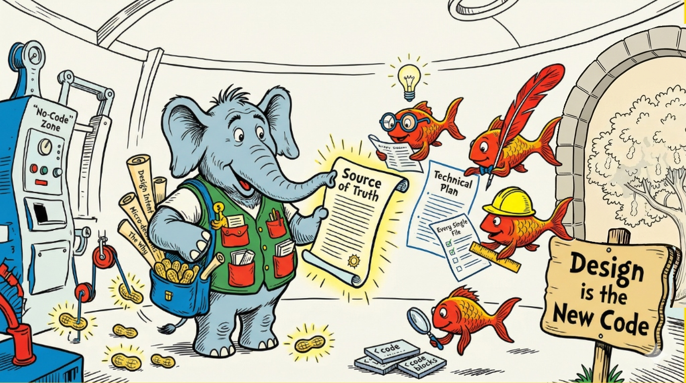

<!--
Copyright 2026 Google LLC.
SPDX-License-Identifier: Apache-2.0
-->

# Elephant & Goldfish Model (EGM)

EGM helps you draft software designs and review them with fresh-context AI agents before implementation. It packages reusable skills, reviewer prompts, and document standards for AI coding tools.

Use it when a change needs discussion of requirements, trade-offs, or architecture. You can also review an existing design or check whether code still matches it. A small bug fix may not need the full workflow.

## Quickstart

You need an AI coding tool with subagent support, access to a model, and a project to work on. Follow the [installation instructions for your tool](docs/harnesses.md#install) and install the whole plugin, including its personas and standards. Model access may require a subscription or API charges.

In your project's agent session, run one step at a time:

1. Run `/egm-brainstorm` and describe a change, such as adding CSV export to a report. Answer the clarification questions; the session produces a `concepts_brief.md`.
2. Run `/egm-draft` with that brief to write a design under `docs/designs/` or your chosen directory.
3. Run `/egm-review docs/designs/csv-export.md`, using the actual draft path. Review the findings and work through proposed changes with `/egm-resolve`.
4. Have a person review the design before implementing it. AI review findings are input to that decision, not proof that the design is correct.

Command names can vary by tool; check your harness's plugin documentation for its prefix.

See [Getting started](docs/getting_started.md) for the full workflow. Installation alone does not establish support: the [harness guide](docs/harnesses.md#support-status) defines the required end-to-end checks, and [Testing](TESTING.md) explains how to run evaluations.

## How it works

The names describe two roles:

- **Elephant:** drafts with the project history, requirements, and architectural context you provide.
- **Goldfish:** reviews in a fresh subagent context, without the drafting conversation. Reviewers examine the design, relevant code, and supplied standards from different perspectives.

Fresh context depends on the host tool's delegation and instruction handling; it does not mean the reviewer has no instructions or cannot access files. People choose which findings to act on and remain responsible for the outcome.

The approach comes from Dave Rensin's [Elephants, Goldfish, and the New Golden Age of Software Engineering](https://medium.com/@drensin/elephants-goldfish-and-the-new-golden-age-of-software-engineering-c33641a48874).

## Skills

| Command | Use it to |
| :------ | :-------- |
| `/egm-brainstorm` | Explore an idea and test its assumptions before drafting. |
| `/egm-draft` | Write a design document section by section. |
| `/egm-review` | Review a design for clarity, consistency, and implementation readiness. |
| `/egm-review-loop` | Coordinate several reviewers for a review task. |
| `/egm-resolve` | Work through review findings and apply agreed changes. |
| `/egm-drift-report` | Compare design documents with the code they describe. |
| `/egm-bootstrap` | Generate initial documentation for an existing codebase. |

## Agents

Skills delegate work to these personas. Each group is listed alphabetically; the skill determines which agents run and in what order.

### Reviewers

| Agent | Role |
| :---- | :--- |
| [Codebase details](agents/codebase_details.md) | Check documentation against the implementation and available libraries. |
| [Comprehension](agents/comprehension.md) | Find undefined terms and gaps that would confuse a new reader. |
| [Design critic](agents/design_critic.md) | Challenge architecture, scalability, costs, and unresolved risks. |
| [Implementation readiness](agents/implementation_readiness.md) | Check that an implementer can proceed without making missing design decisions. |
| [Structural](agents/structural.md) | Check document organization, headings, and template compliance. |
| [Style](agents/style.md) | Edit for clarity, precision, and brevity. |
| [Zoom out](agents/zoom_out.md) | Question complexity and look for simpler approaches or existing code to reuse. |

### Coordinators

| Agent | Role |
| :---- | :--- |
| [Bootstrap orchestrator](agents/bootstrap_orchestrator.md) | Divide a codebase into subtrees and coordinate documentation workers. |
| [Synthesizer](agents/synthesizer.md) | Coordinate reviewers and combine findings without duplicates. |

## Documentation and help

- [Getting started](docs/getting_started.md): setup and workflow examples.
- [Harnesses](docs/harnesses.md): installation, delegation, and support requirements.
- [Architecture](docs/designs/architecture.md): how the framework fits together.
- [Testing](TESTING.md): static checks and behavioral evaluations.
- [Issues](https://github.com/google/elephant-goldfish-model/issues): report a problem or ask a question. Include your tool, version, command, and relevant output.

The repository keeps skill instructions in `skills/`, reviewer personas in `agents/`, and review standards in `resources/document_standards/`. Guides and design documents live in `docs/`; validation code lives in `tests/` and `tools/`.

## Contributing

Read the [contribution guidelines](CONTRIBUTING.md) for review requirements, contribution tracks, and the contributor license agreement. Documentation fixes, bug reports, and reviewer improvements are welcome.

## License

Licensed under [Apache 2.0](LICENSE). This is not an officially supported Google product.
