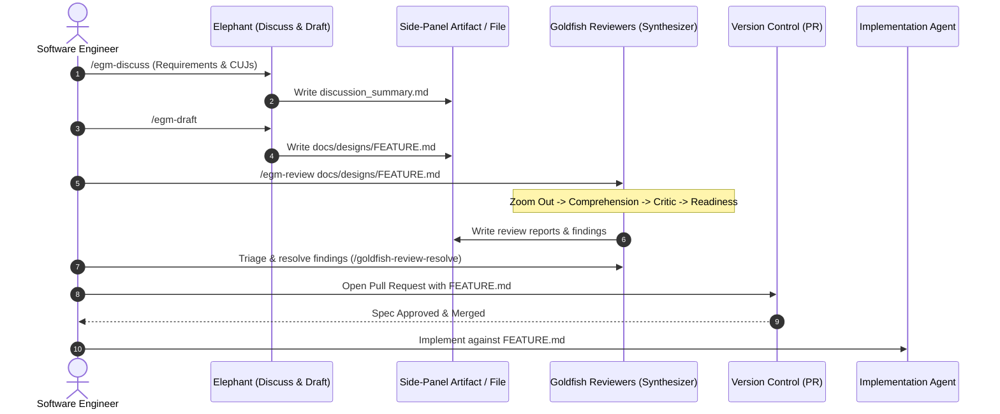

<!--
Copyright 2026 Google LLC

Licensed under the Apache License, Version 2.0 (the "License");
you may not use this file except in compliance with the License.
You may obtain a copy of the License at

    https://www.apache.org/licenses/LICENSE-2.0

Unless required by applicable law or agreed to in writing, software
distributed under the License is distributed on an "AS IS" BASIS,
WITHOUT WARRANTIES OR CONDITIONS OF ANY KIND, either express or implied.
See the License for the specific language governing permissions and
limitations under the License.
-->

# EGM Architecture & System Lifecycle

*   **Authors:** Jim Quinn ([@quinnjim](https://github.com/quinnjim)), Elise Ewing ([@eewing314](https://github.com/eewing314)), Dave Rensin ([@drensin](https://github.com/drensin))
*   **Status:** Current
*   **Date:** 2026-08-20

--------------------------------------------------------------------------------

## Overview

The **Elephant & Goldfish Model (EGM)** is an implementation of Spec-Driven
Development (SDD) based on [Elephants, Goldfish, and the New Golden Age of Software Engineering](https://medium.com/@drensin/elephants-goldfish-and-the-new-golden-age-of-software-engineering-c33641a48874).
It emphasizes collaborative use of AI for design and review, maintaining verified
technical specifications checked directly into the codebase.

This document specifies the overarching system architecture of EGM: its
component model, its end-to-end dataflow, and its lifecycle across coding agent
runtimes.

## The Problem

Unstructured, conversational AI code generation suffers from four systemic
failure modes:

1.  **Hallucination Cascades & Context Pollution**: When a single LLM thread
    interviews the developer, creates the design, and writes the code, the
    session context accumulates speculative hypotheses and conversational bias.
    The model validates its own faulty assumptions instead of detecting errors.
2.  **Premature Implementation ("Weeds Syndrome")**: Coding agents default to
    writing code immediately in nearby files, bypassing high-level architectural
    placement, simplicity checks (YAGNI), and existing infrastructure reuse.
3.  **Chat Dump Fatigue**: Presenting multi-page design specs or lengthy review
    feedback directly in chat windows clutters conversation history, degrades
    LLM context performance, and creates poor user ergonomics.
4.  **Documentation Drift**: Design documents written during project kickoff
    routinely rot as code evolves, breaking future AI agent onboarding.

## Design Principles

*   **Elephant & Goldfish**:

    *   **The Elephant**: A deep-context agent loaded with system history, CUJs,
        and codebase maps to explore requirements and draft designs.
    *   **The Goldfish**: Isolated, zero-context subagent reviewers evaluating
        drafts against rubrics without access to context bias.

*   **Human Ownership**: AI is a tool for exploration and review; the human
    engineer is responsible for architectural decisions, trade-offs, and owns
    the outcome.

*   **Artifact-First UX**: All long-form deliverables (drafts, summaries, review
    reports) are rendered into dedicated side-panel markdown artifacts or
    workspace files with interactive feedback checkpoints.

*   **Living Specifications**: Designs are checked-in artifacts in the source
    tree (`docs/designs/`), continuously monitored against codebase drift.

## System Architecture & Component Model

The open-source EGM framework is organized into five decoupled subsystems:

### 1. Skills Layer (`skills/`)
Modular agent capabilities executable via slash commands or direct invocation:
*   `egm_discuss`: Interactive requirements elicitation and Socratic questioning.
*   `egm_draft`: Section-by-section specification compiler.
*   `egm_review`: Orchestrator for the multi-stage review pipeline.
*   `goldfish_review_loop`: Concurrent subagent review dispatcher.
*   `goldfish_review_resolve`: Interactive resolution and patch application.
*   `egm_drift_report`: AST drift scanner between specs and active code.
*   `egm_bootstrap`: Recursive bottom-up codebase documentation generator.
*   `egm_brainstorm`: 6-lens shootdown swarm for early concept exploration.

### 2. Personas Layer (`personas/`)
Stateless system prompt instructions for isolated Goldfish reviewer subagents
(Comprehension, Design Critic, Implementation Readiness, Codebase Auditor,
Structural Validator, Style Editor, and Synthesizer).

### 3. Rules Layer (`rules/`)
Continuous cognitive and operational constraints injected into agent sessions:
*   `anti_sycophancy.md`: Eliminates hollow praise and mandates adversarial
    stress-testing of user ideas.
*   `search_terms.md`: Enforces symbol-based references over brittle line numbers.
*   `pr_tagging.md`: Standardizes pull request categorization.

### 4. Document Standards (`resources/document_standards/`)
Objective evaluation rubrics used by Goldfish reviewers to grade specifications:
*   `heilmeier-standard.md`: Problem clarity and value proposition.
*   `zoom-out-standard.md`: Simplicity, YAGNI, and codebase reuse.
*   `feature-spec-standard.md`: Architecture completeness and scale limits.
*   `implementation-readiness-standard.md`: Path verification and test readiness.
*   `re-implementation-standard.md`: Codebase state documentation bar.

### 5. Living Documentation (`docs/`)
User guides (`getting_started.md`, `faq.md`) and technical design specifications
(`docs/designs/`).

## End-to-End Lifecycle & Dataflow

The EGM development pipeline transitions artifacts through five disciplined
phases:

### Phase 1: Context & Elicitation (The Elephant)

*   **Command**: `/egm-discuss`
*   **Mechanics**: The Elephant interviews the engineer, extracting core
    objectives, failure modes, alternatives, and trade-offs.
*   **Output**: A structured summary written to `discussion_summary.md`.

### Phase 2: Spec Authoring & Semantic Boundaries

*   **Command**: `/egm-draft`
*   **Mechanics**: Converts the discussion summary into an EGM-compliant
    technical design document written to `docs/designs/<feature>.md`.
*   **Semantic Boundary Discovery**: Establishes a clear boundary between the
    high-level architecture (`FeatureRange`) and the detailed implementation
    plan (`DetailedRange`), enabling targeted subagent reviews.

### Phase 3: Isolated Verification (The Goldfish)

*   **Command**: `/egm-review`
*   **Execution**: Executes a 4-tier evaluation pipeline:
    1.  **Step 5: Zoom Out Review**: Evaluates simplicity, YAGNI, and codebase
        reuse against `zoom-out-standard.md`.
    2.  **Step 6: Comprehension Test**: Isolated naive reader audits the doc for
        self-containment and missing background knowledge.
    3.  **Step 7: Critic Review**: Evaluates system design, scale bottlenecks,
        and failure modes against `feature-spec-standard.md`.
    4.  **Step 8: Implementation Readiness Test**: Verifies file paths, function
        signatures, and test cases against
        `implementation-readiness-standard.md`.
*   **Subagent Fan-Out/Fan-In**: The `synthesizer` persona spawns isolated
    reviewers in parallel, aggregates raw findings, deduplicates overlaps, and
    writes consolidated markdown reports.

### Phase 4: Human Review & Submission

*   The human engineer resolves or rejects Goldfish findings using
    `/goldfish-review-resolve`, updates the design doc, and submits the
    specification via Pull Request for human peer review.

### Phase 5: Implementation & Drift Monitoring

*   **Execution**: Coding agents implement code strictly adhering to the
    approved design document.
*   **Maintenance**: `/egm-drift-report` is run periodically (e.g. weekly) to
    detect divergence between codebase implementations and checked-in design docs.

## Artifact-First UX Protocol

To maintain conversation health and prevent context degradation, all EGM skills
adhere to the following UX protocol:

1.  **Chat Dump Prohibition**: Tools and skills must never dump large proposals,
    drafts, or review logs into the main chat stream.
2.  **Artifact Emission**: All content must be written directly to dedicated
    side-panel artifacts (with `RequestFeedback: true` in Antigravity) or to
    persistent workspace files.
3.  **Turn-Yielding Checkpoints**: When user feedback or triage is required, the
    calling skill notifies the user with a concise message pointing to the
    artifact and yields execution.
4.  **Queue Clearance**: Once the user completes a checkpoint review, the
    calling skill clears pending feedback markers.

## References

*   Dave Rensin, [Elephants, Goldfish, and the New Golden Age of Software Engineering](https://medium.com/@drensin/elephants-goldfish-and-the-new-golden-age-of-software-engineering-c33641a48874) (Medium, 2026).

## Alternatives Considered

*   **Monolithic In-Thread Review vs. Multi-Subagent Pipeline**:
    *   *Alternative*: Run review prompts sequentially within the same chat
        session.
    *   *Rejection*: Severe context degradation and confirmation bias; the model
        validates its own mistakes.
*   **Direct-to-Code vs. Spec-Driven Development**:
    *   *Alternative*: Prompting agents to generate code directly from feature
        requests.
    *   *Rejection*: Results in higher comment density per kLOC, duplicated
        utility implementations, and zero checked-in architectural memory.
