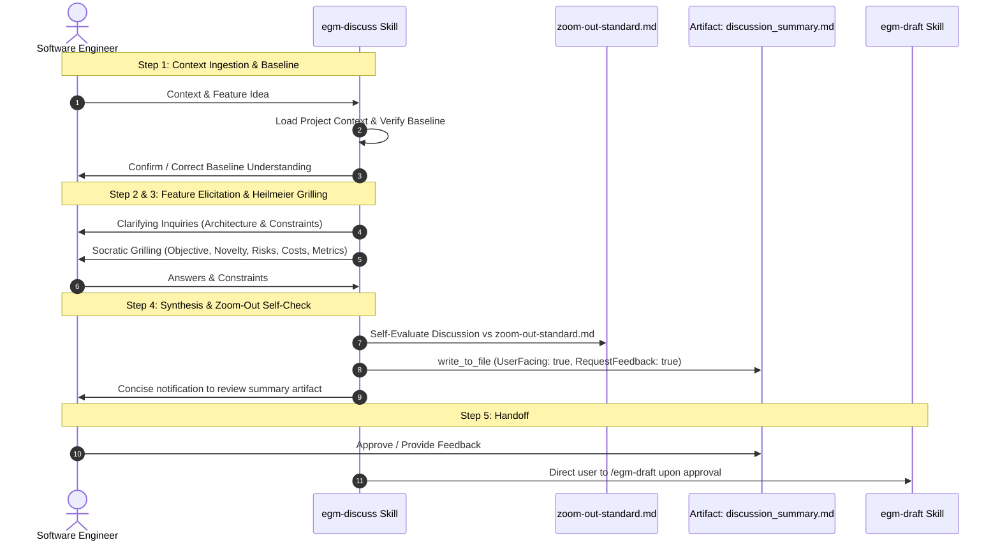

<!--
Copyright 2026 Google LLC

Licensed under the Apache License, Version 2.0 (the "License");
you may not use this file except in compliance with the License.
You may obtain a copy of the License at

    https://www.apache.org/licenses/LICENSE-2.0

Unless required by applicable law or agreed to in writing, software
distributed under the License is distributed on an "AS IS" BASIS,
WITHOUT WARRANTIES OR CONDITIONS OF ANY KIND, either express or implied.
See the License for the specific language governing permissions and
limitations under the License.
-->

# EGM Design Discussion: Problem Alignment & Socratic Grilling

*   **Authors:** Jim Quinn ([@quinnjim](https://github.com/quinnjim)), Elise Ewing ([@eewing314](https://github.com/eewing314))
*   **Status:** Current
*   **Date:** 2026-08-20

--------------------------------------------------------------------------------

## Overview

The **EGM Design Discussion Skill** (`/egm-discuss`) is the interactive design
interview phase of the Elephant & Goldfish Model (EGM). It explores problem
definitions, queries system constraints, aligns on high-level architecture,
challenges assumptions via the Heilmeier framework, and produces a structured
`discussion_summary.md` artifact before handing off to `/egm-draft`.

It is intended to challenge engineers early in the process to prevent premature
coding and unvetted architectural assumptions.

## The Problem

Directly prompting AI agents to author design documents or jump into code
typically fails due to three fundamental flaws:

1.  **Sycophantic Agreement & Superficial Alignment**: Standard conversational
    models often accept the user's initial proposal without probing edge cases,
    operational limits, or non-goals.
2.  **Premature Code Generation**: When asked for a design, models frequently
    generate concrete helper functions and loops instead of establishing
    interfaces, data flows, and architectural boundaries.
3.  **Chat Stream Bloat & Context Decay**: Generating multi-thousand-word
    specifications in the chat pane degrades context and forces engineers to
    scroll through massive walls of text.

## Design Principles

*   **Socratic & Antagonistic Grilling**: The Elephant must actively question
    assumptions, highlight single points of failure (SPOFs), and evaluate
    alternatives using structured frameworks (e.g., the Heilmeier Catechism).
*   **Artifact-First Delivery**: Large summaries and notes are strictly
    forbidden from the chat pane. All working state is rendered into side-panel
    artifacts or persistent workspace files (`discussion_summary.md`) with
    interactive feedback gates.
*   **Zoom-Out Self-Evaluation**: The authoring agent self-evaluates proposals
    against [zoom-out-standard.md](../../skills/egm_discuss/references/zoom-out-standard.md)
    during discussion to catch YAGNI, premature optimizations, and reinvention early.
*   **Structured Interactive Inquiries**: To minimize cognitive load,
    clarifying questions are posed one at a time, surfacing recommended paths
    with `(Recommended)` prefixes.

## System Architecture & Workflow

--------------------------------------------------------------------------------

## The Discussion Protocol (`/egm-discuss`)

The `/egm-discuss` workflow runs in sequential stages:

### Step 1: Context Ingestion & Baseline Verification

The agent checks for project documentation, codebase paths, and architecture
diagrams. It reads the materials, synthesizes a concise baseline summary, and
explicitly asks the engineer to confirm or correct its understanding.

### Step 2: Feature Elicitation & Partnership

The engineer introduces the feature proposal. The agent acts as an architectural
partner, asking clarifying questions via structured choice dialogs
(`ask_question`) and surfacing recommended paths with `(Recommended)` prefixes.

### Step 3: Requirements Grilling (Heilmeier Framework)

The agent adopts an antagonistic persona, evaluating the feature against the
Heilmeier[^heilmeier] questions:

1.  *Objective*: What are you trying to do? (No jargon).
2.  *Current Limits*: How is it done today, and what are the limitations?
3.  *New Approach*: What is novel, and why will it succeed?
4.  *Impact*: Who benefits, and what measurable difference will it make?
5.  *Risks*: What are the failure modes and operational risks?
6.  *Cost*: What is the compute, storage, token, and engineering cost?
7.  *Verification*: What tests and metrics prove success?

Heilmeier should not be mentioned by name by the skill, as this would appear as
jargon to end users. Grilling questions are asked one-by-one with inferred
choices to minimize engineer friction.

### Step 4: Synthesis & Zoom-Out Self-Check

The agent synthesizes the discussion, performs a self-check against
[zoom-out-standard.md](../../skills/egm_discuss/references/zoom-out-standard.md)
to ensure simplicity and reuse, and writes `discussion_summary.md` to the artifact
directory or project workspace with feedback requested.

### Step 5: Handoff

Upon user consensus, the agent yields execution and directs the user to
`/egm-draft`.

--------------------------------------------------------------------------------

## Standards Alignment

| Authoring Step | Governing Standard | Focus Area |
| :------------- | :----------------- | :--------- |
| Discussion Grilling | [`heilmeier-standard.md`](../../resources/document_standards/heilmeier-standard.md) | Problem clarity, quantifiable value, risk analysis |
| Architecture Outline | [`zoom-out-standard.md`](../../resources/document_standards/zoom-out-standard.md) | Simplicity, YAGNI, existing infrastructure reuse |

--------------------------------------------------------------------------------

## Implementation Files

The discussion capability is implemented across the following skill and reference files:

| File Path | Type | Purpose & Reason for Existence |
| :-------- | :--- | :----------------------------- |
| `skills/egm_discuss/SKILL.md` | Skill Definition | Implements `/egm-discuss` orchestration, Socratic requirements grilling, and discussion summary artifact generation. |
| `skills/egm_discuss/TEST.md` | Unit Tests | Verification test scenarios testing `/egm-discuss` stage transitions and prompt formatting. |
| `skills/egm_discuss/test_scenarios.yaml` | Evaluation Benchmark | Co-located behavioral eval suite evaluating model adherence to the discussion protocol. |
| `skills/egm_discuss/references/instructions.md` | Execution Instructions | Core execution rules enforcing one-question-at-a-time pacing and anti-sycophancy. |
| `skills/egm_discuss/references/zoom-out-standard.md` | Reference Standard | Architectural evaluation rubric for YAGNI, reuse, and complexity minimization. |

--------------------------------------------------------------------------------

## References

*   Dave Rensin, [Elephants, Goldfish, and the New Golden Age of Software Engineering](https://medium.com/@drensin/elephants-goldfish-and-the-new-golden-age-of-software-engineering-c33641a48874) (Medium, 2026).
*   DARPA, [The Heilmeier Catechism](https://www.darpa.mil/about/heilmeier-catechism).
