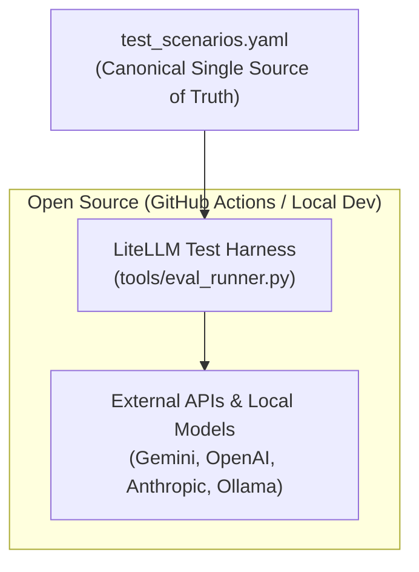

<!--
Copyright 2026 Google LLC.
SPDX-License-Identifier: Apache-2.0
-->

# Open-Source EGM Testing Architecture & Evaluation Framework

## 1. Problem Statement & Overview

### 1.1 The Problem

Without an accessible, automated testing suite, contributors and CI/CD
environments cannot deterministically verify whether changes to skills or
system prompts break core behavioral invariants (such as the silent no-code
rule, single-question pacing, artifact-first delivery, and review gating) or
introduce syntax and schema defects.

### 1.2 Architectural Concepts & Terminology

To understand the multi-agent EGM flow and system invariants, see [architecture.md](architecture.md).

### 1.3 Overview

This project introduces a two-tiered testing and evaluation framework for the
open-source EGM repository:

1.  **Tier 1 (Static Verification Suite)**: Hermetic, offline Python unit tests
    executed via `pytest` to enforce YAML frontmatter schema validity and
    relative link integrity. These tests read all `SKILL.md` files in the
    `skills/` directory to test, and run automatically on every pull request
    and require no external API keys.
2.  **Tier 2 (Provider-Agnostic Behavioral Evaluation Suite)**: A lightweight
    CLI test harness (`tools/eval_runner.py`) using
    [LiteLLM](https://docs.litellm.ai/)
    ([GitHub](https://github.com/BerriAI/litellm)) that executes declarative
    YAML scenarios (`test_scenarios.yaml`) co-located directly within each skill
    package. Evaluates agent behavioral adherence to the EGM flow and system
    invariants on-demand for local developers or during optional scheduled CI runs.

--------------------------------------------------------------------------------

## 2. Goals & Non-Goals

### 2.1 Goals

*   **Automated PR Gating**: Hermetic static test suite running in GitHub
    Actions quickly on every pull request without requiring API keys or network
    access.
*   **Automatic Multi-Skill Discovery**: Automatic discovery and test execution
    across all skill packages in the `skills/` directory without requiring
    hardcoded path lists or manual test registration.
*   **Antigravity Support**: Support Antigravity initially, but enable expansion
    to other runtimes with LiteLLM rather than an Antigravity-specific harness.
*   **Single Source of Truth**: Declarative `test_scenarios.yaml` co-located
    within each skill package acts as the sole source of truth for behavioral
    evaluations across test runners.
*   **Minimal Dependencies**: Python implementation with minimal external
    dependencies (`pytest`, `pyyaml`, `litellm`).

### 2.2 Non-Goals

*   **Offline Mock Response Replay Subsystem**: No JSON response serialization
    caches; static unit tests and live model runs handle verification.
*   **Distributed Multi-Agent Swarm Simulation**: Behavioral evaluations test
    individual skill and subagent prompts at unit boundaries, not as a live
    virtual swarm runtime.
*   **Core Skill Modifications**: Infrastructure-only scope; no operational
    changes to EGM skill or persona prompts.

### 2.3 Alternatives Considered

#### Alternative A: Mock Response Replay Subsystem (Offline Recorded Mocks)

*   **Description**: Capture and serialize full multi-turn LLM response JSON
    payloads to disk, replaying them during CI without network connectivity.
*   **Pros**: Zero API runtime cost and zero network latency.
    *   High maintenance overhead and fidelity degradation over time to hidden
        nondeterminism as prompts and model capabilities evolve.
*   **Reason for Rejection**: The cost of this solution is unnecessary to
    achieve the goals of automated PR gating and offline evaluation.

#### Alternative B: Centralized `tests/behavioral/` vs. Co-located `test_scenarios.yaml`

*   **Description**: Placing scenario files under a centralized
    `tests/behavioral/<skill>/scenarios.yaml` tree versus directly inside each
    skill folder (`skills/<skill>/test_scenarios.yaml`).
*   **Pros of Co-location**: Keeps each skill package 100% self-contained with
    its prompt (`SKILL.md`), test instructions (`TEST.md`), and automated
    scenarios (`test_scenarios.yaml`).
*   **Cons**: Dynamic runner must discover scenario files across skill
    directories rather than reading a single subfolder.
*   **Decision**: Adopt co-located `test_scenarios.yaml` per skill to maintain
    modular skill package boundaries.

#### Alternative C: Third-Party Agent Evaluation Frameworks

*   **Description**: Adopt external third-party evaluation frameworks (such as
    [Promptfoo](https://github.com/promptfoo/promptfoo),
    [DeepEval](https://github.com/confident-ai/deepeval), or
    [Inspect AI](https://github.com/UKGovernmentBEIS/inspect_ai)).
*   **Trade-off Analysis**:
    *   *Promptfoo*: Requires a Node.js/TypeScript runtime environment, adding
        multi-runtime complexity to a pure Python skill suite.
    *   *DeepEval*: Introduces heavy dependencies (e.g. LangChain ecosystem) and
        opinionated RAG-specific metrics (answer relevancy, hallucination)
        unnecessary for deterministic prompt rule assertions.
    *   *Inspect AI*: Designed for large-scale AI safety benchmarks and
        sandboxed tool execution, exceeding the requirements for lightweight
        skill prompt verification.
*   **Reason for Rejection**: A custom, lightweight Python runner
    (`tools/eval_runner.py`) using `litellm` provides unified multi-provider
    support with minimal dependencies (`pytest`, `pyyaml`, `litellm`) and
    assertion primitives tailored directly to EGM invariants.

#### Alternative D: Implementation Language (Python vs. Go)

*   **Description**: Implementing the static checks and evaluation harness in Go
    versus Python.
*   **Trade-off Analysis**:
    *   *Go*: Fast compilation, single binary deployment, and strong typing.
        However, lack of an equivalent to LiteLLM would require maintaining
        custom REST/gRPC client wrappers for Gemini, OpenAI, Anthropic, and
        Ollama.
    *   *Python*: Direct integration with `litellm` for unified multi-provider
        calling, native `pytest` fixture ecosystem, and alignment with
        open-source agent prompt testing tools.
*   **Decision**: Implement in Python; consider Go tooling for standalone static
    linters in future iterations if execution performance warrants.

### 2.4 Risks & Mitigations

*   **Risk: Non-Deterministic LLM Behavioral Outputs and Intermittent
    Failures**: Live model evaluations can exhibit stochastic outputs, leading
    to intermittent test failures.
    *   *Mitigation*: Tier 1 static unit tests gate all PRs deterministically in
        CI. Tier 2 behavioral evaluations use greedy decoding
        ([temperature 0.0](https://en.wikipedia.org/wiki/Temperature_(machine_learning)))
        to minimize stochastic sampling variance across runs, paired with
        deterministic regex/substring checks where possible, and clear rubric
        guidelines with retry tolerances for LLM-as-a-judge scoring.
*   **Risk: API Key Requirements & Contributor Access**: External developers may
    not have paid commercial API keys.
    *   *Mitigation*: Running PR CI requires no API keys (Tier 1 unit tests
        only). For Tier 2 behavioral runs, `eval_runner.py` supports local model
        runtimes (e.g., Ollama) without credentials, as well as Gemini, OpenAI,
        and Anthropic keys supplied via standard environment variables
        (`GEMINI_API_KEY`, `OPENAI_API_KEY`, `ANTHROPIC_API_KEY`).
    *   *Mitigation*: We require contributors to run their changes locally,
        requiring some access to Antigravity or another AI tool, which can
        also be used to run the eval harness.
*   **Risk: Secret Leakage & CI Cost Overruns**: Exposing API keys in public CI
    can risk credential leaks and uncontrolled token expenditure.
    *   *Mitigation*: Tier 2 behavioral workflows in GitHub Actions run only on
        manual `workflow_dispatch` (with repository maintainer secrets) or
        scheduled nightlies, strictly isolated from external PR forks.

--------------------------------------------------------------------------------

## 3. Technical Architecture & Test Suite Specification

### 3.1 Directory Structure

```text
egm/
├── .github/
│   └── workflows/
│       ├── test-unit.yaml             # Tier 1 CI check on every PR (hermetic, no keys)
│       └── eval-behavioral.yaml       # Tier 2 manual / scheduled dispatch
├── agents/                            # Stateless reviewer & orchestrator personas
├── skills/                            # EGM skill packages
│   └── <skill>/
│       ├── SKILL.md                   # Skill prompt & instructions
│       └── test_scenarios.yaml        # Tier 2 behavioral evaluation scenarios
├── tests/
│   ├── conftest.py                    # Pytest configuration & root path discovery
│   ├── unit/                          # Tier 1 Static Checks
│   │   ├── test_frontmatter.py        # YAML frontmatter schema & attributes
│   │   ├── test_link_integrity.py     # Relative markdown link integrity
│   │   ├── test_scenario_coverage.py  # Dynamic scenario coverage & schema check
│   │   └── test_eval_runner.py        # Unit tests for harness logic (isolated)
├── tools/
│   └── eval_runner.py                 # LiteLLM execution harness (lazy imports)
├── pyproject.toml
├── requirements-dev.txt
└── TESTING.md                         # Developer testing & evaluation playbook
```

### 3.1.1 Development Configuration & Documentation Files

*   **`pyproject.toml`**: Standard Python project configuration file (PEP 518/621)
    defining tool settings. Configures `pytest` test discovery paths, Python search
    paths (`pythonpath = ["."]`), and test execution options.
*   **`requirements-dev.txt`**: Specifies pinned test and development dependencies
    (`pytest>=8.0.0`, `pyyaml>=6.0`, `litellm>=1.40.0`) required for local
    developer environments and GitHub Actions CI workflows.
*   **`TESTING.md`**: Developer and contributor testing guide (following standard
    GitHub repository documentation practices) providing clear step-by-step
    instructions for executing Tier 1 static unit tests locally and running
    Tier 2 behavioral evaluation suites across supported model backends.

### 3.2 Tier 1: Static Verification Suite Specifications & Dynamic Discovery

#### Repository Root Discovery Contract

Test modules resolve filesystem paths via a shared `repo_root` and `skills_dir`
pytest fixture defined centrally in `tests/conftest.py`. The fixture dynamically
detects the active repository layout (`skills` vs. `plugins/egm/skills`) by traversing parent
directories from the test runner. When a new skill directory is added or
modified, the test harness automatically includes it in the test matrix without
requiring changes to configuration or CI workflows.

Test Module                  | Dynamic Discovery & Check Logic                                                                                                                                                                                                                                                                                                                                                                                                                                     | Error Condition
:--------------------------- | :------------------------------------------------------------------------------------------------------------------------------------------------------------------------------------------------------------------------------------------------------------------------------------------------------------------------------------------------------------------------------------------------------------------------------------------------------------------ | :--------------
`test_frontmatter.py`        | Scans all `SKILL.md` files across discovered skill folders. Validates YAML parsing and required keys (`name`, `description`). Validates optional attributes like `disable-model-invocation: true`.                                                                                                                                                                                                                                                                  | Fails if frontmatter is missing, malformed, or missing required schema keys.
`test_link_integrity.py`     | Dynamically parses markdown cross-references and links (`[text](target)`). Ignores external URI schemes (`http://`, `https://`, `mailto:`) Validates local anchor fragments (`#heading`) against headers within the referring document. Strips anchor fragments on file links and resolves relative targets against the referring document's directory (`source_file.parent`). | Fails if any referenced local target file does not exist on disk.
`test_scenario_coverage.py`  | Dynamically discovers all skill packages via `discovered_skills`. Verifies that 100% of discovered skills contain a co-located `test_scenarios.yaml` suite with matching `skill` metadata and non-empty `scenarios` conforming to the schema.                                                                                                                                                                                                                    | Fails if any discovered skill lacks a scenario suite or contains invalid scenario definitions.
`test_eval_runner.py`        | Verifies harness utility methods (metric parsing, rubric formatting, exit codes, scenario normalization) using hermetic inline fixtures without requiring external network access or runtime LLM credentials.                                                                                                                                                                                                                                                       | Fails if evaluation harness parsing logic regresses.

#### Dynamic Scenario Schema & Coverage Verification (`test_scenario_coverage.py`)

To guarantee 100% scenario coverage across all skills without maintaining
hardcoded skill registries in build files (such as a static `ALL_SKILLS` registry), scenario coverage verification is executed dynamically
within the Tier 1 static unit test suite
([test_scenario_coverage.py](../../tests/unit/test_scenario_coverage.py)):

1.  **Zero-Maintenance Dynamic Discovery**: Tests consume the `discovered_skills`
    pytest fixture from `tests/conftest.py`, automatically discovering any newly
    created skill package on disk without configuration changes.
2.  **Scenario Coverage**: Verifies that every discovered skill directory
    contains a co-located `test_scenarios.yaml` file defining at least one
    behavioral scenario.
3.  **Schema Validity**: Ensures YAML parsing succeeds, `skill` matches the
    containing directory name, and all required keys (`scenario_id`, `eval_type`,
    `turns`) conform to the specification.
4.  **Hermetic CI Gating**: Executes automatically as part of PR gating in
    GitHub Actions and during local `pytest` test runs.



### 3.3 Tier 2: Behavioral Scenario Schema & Evaluation Harness Architecture

#### 3.3.1 Behavioral Evaluation Execution Boundary

To prevent scope creep and maintain strict alignment with Non-Goal 2.2, Tier 2
behavioral evaluations are formally bounded to **agent-level persona and prompt
verification**:

*   **Subagent Personas** (e.g., `egm_comprehension`, `egm_design`,
    `egm_zoom_out`): Evaluated by injecting a test document directly into the
    subagent's system prompt and asserting that its single-turn completion
    catches target defects.
*   **Orchestrator Skills** (e.g., `egm_review`, `egm_review_loop`):
    Evaluated by asserting that the orchestrator properly constructs review
    prompts, enforces single-question pacing, respects tool invocation
    boundaries, and generates structured report deliverables without attempting
    to simulate a live distributed multi-agent swarm in the test runner.

This maintains functional parity with previous evaluation suites without
requiring a distributed multi-agent swarm runtime.

#### 3.3.2 Canonical `test_scenarios.yaml` Schema

All paths in `test_scenarios.yaml` (e.g., `skill_file`) are
specified relative to the repository root directory housing the test framework.

````yaml
# skills/<skill>/test_scenarios.yaml
skill: "egm_draft"
description: "Behavioral eval scenarios for egm_draft"
scenarios:
  # Deterministic Scenario Example
  - scenario_id: "ingest_brief_and_draft"
    description: "Verifies agent does not output design drafts in turn 1; asks clarifying questions."
    eval_type: "deterministic"
    system_prompt:
      skill_file: "skills/egm_draft/SKILL.md"
    turns:
      - user_input: "Help me design a new user caching service."
        assertions:
          - type: "forbidden_pattern"
            pattern: "```[a-zA-Z]*\n"
            message: "Agent output forbidden code blocks during discussion."
          - type: "required_pattern"
            pattern: "\\?"
            message: "Agent must ask clarifying requirements questions."

  # LLM Judge Scenario Example
  - scenario_id: "comprehension_auditor_undefined_jargon"
    description: "Verifies comprehension reviewer flags undefined terminology."
    eval_type: "llm_judge"
    system_prompt:
      skill_file: "skills/egm_review/SKILL.md"
    turns:
      - user_input: "Review this draft containing undefined term 'QuasarCache'."
        rubric:
          prompt: "Verify whether the agent identifies 'QuasarCache' as an undefined term and requests clarification."
          passing_criteria: "Agent explicitly lists QuasarCache in findings."
````

#### Supported Assertion Primitives

*   `required_pattern`: Regex pattern that must match in model response.
*   `forbidden_pattern`: Regex pattern that must NOT match in model response.
*   `contains`: Substring that must be present.
*   `not_contains`: Substring that must NOT be present.

#### 3.3.3 Evaluation Runner CLI (`tools/eval_runner.py`)

`tools/eval_runner.py` acts as the execution harness evaluating
`test_scenarios.yaml` against LiteLLM supported backends. To maintain dependency
isolation for Tier 1 static checks, `litellm` is loaded lazily inside
`eval_runner.py` only when live model evaluations are invoked.

```bash
# Run all scenarios for a specific skill against Gemini
python tools/eval_runner.py --skill egm_draft --model gemini/gemini-2.5-flash

# Run an LLM-judged scenario with a dedicated judge model
python tools/eval_runner.py --skill egm_review --scenario comprehension_auditor_undefined_jargon --model ollama/llama3 --judge-model gemini/gemini-2.5-pro
```

*   **CLI Parameters**:
    *   `--skill <name>`: Target skill directory name (supports hyphen or
        underscore; normalized automatically).
    *   `--scenario <id>`: (Optional) Run a specific scenario ID within the
        skill suite.
    *   `--model <model_string>`: Model identifier passed to LiteLLM (default:
        `gemini/gemini-2.5-flash`).
    *   `--judge-model <model_string>`: (Optional) Dedicated judge model for
        `llm_judge` scenarios (default: same as `--model`).
    *   `--temperature <float>`: Sampling temperature (default: `0.0` for
        deterministic evaluation).
    *   `--output-dir <path>`: Directory to write structured eval JSON reports
        (default: `eval_results/`).
*   **Exit Codes**:
    *   `0`: All scenarios passed.
    *   `1`: One or more scenario assertions or rubrics failed.
    *   `2`: CLI argument, configuration, or runtime execution error.
*   **Credentials Model**: Developers supply their own provider API keys via
    standard environment variables (`GEMINI_API_KEY`, `OPENAI_API_KEY`,
    `ANTHROPIC_API_KEY`) or specify local model endpoints via `OLLAMA_API_BASE`.

--------------------------------------------------------------------------------

## 4. Tier 2: Behavioral Scenario Mappings

Declarative behavioral evaluation suites (`test_scenarios.yaml`) are co-located
directly within each skill package. Detailed scenario specifications, test
matrices, and assertion criteria are documented within each skill's respective
design specification under the `## Behavioral Testing & Evaluation Scenarios`
section:

*   **[brainstorm.md](brainstorm.md)**: `egm_brainstorm` divergence and decision
    matrix generation scenarios.
*   **[draft.md](draft.md)**: `egm_draft` section drafting, single-question pacing,
    silent no-code enforcement, and artifact-first delivery scenarios.
*   **[drift_report.md](drift_report.md)**: `egm_drift_report` AST and spec
    divergence detection scenarios.
*   **[egm_peanuts_hay_bootstrap.md](egm_peanuts_hay_bootstrap.md)**:
    `egm_peanuts_hay_bootstrap` tree initialization and safety gating scenarios.
*   **[lite.md](lite.md)**: `egm_lite` 4-phase state transitions, critique pause
    gating, and checklist update scenarios.
*   **[review.md](review.md)**: `egm_review`, `egm_review_loop`, and
    `egm_resolve` multi-lens reviewer audits and resolution gating
    scenarios.
*   **[zoom_out.md](zoom_out.md)**: `egm_zoom_out` YAGNI and overengineering
    catch scenarios.

--------------------------------------------------------------------------------

## 5. Implementation Roadmap & Rollout Sequence

### 5.1 Implementation Phases

1.  **Phase 1: Shared Fixtures & Tier 1 Static Verification Suite**:
    *   Implement root discovery fixture and pytest configuration
        (`tests/conftest.py`, `pyproject.toml`, `requirements-dev.txt`).
    *   Implement static validators (`tests/unit/test_frontmatter.py`,
        `tests/unit/test_link_integrity.py`).
    *   Configure automated PR gate pipeline
        (`.github/workflows/test-unit.yaml`).
2.  **Phase 2: LiteLLM Evaluation Harness & Behavioral Scenarios**:
    *   Implement execution CLI harness (`tools/eval_runner.py`) with lazy
        `litellm` loading.
    *   Add isolated unit tests for harness parsing logic
        (`tests/unit/test_eval_runner.py`).
    *   Author co-located behavioral scenario suites
        (`skills/<skill>/test_scenarios.yaml`) across all skill packages.
    *   Configure manual/nightly dispatch pipeline
        (`.github/workflows/eval-behavioral.yaml`).
3.  **Phase 3: Scenario Coverage Verification & Documentation**:
    *   Add dynamic scenario schema and coverage unit test
        ([test_scenario_coverage.py](../../tests/unit/test_scenario_coverage.py)).
    *   Publish open-source testing guide (`TESTING.md`).
