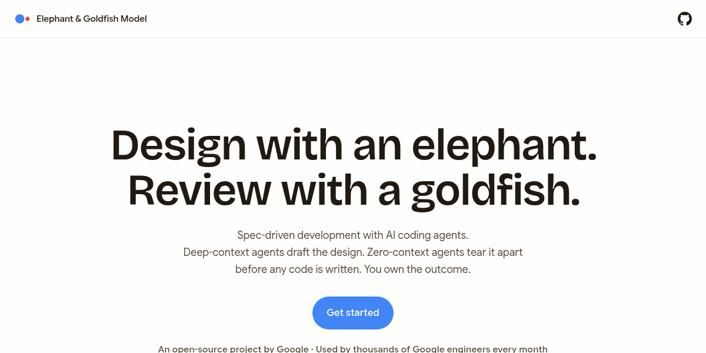
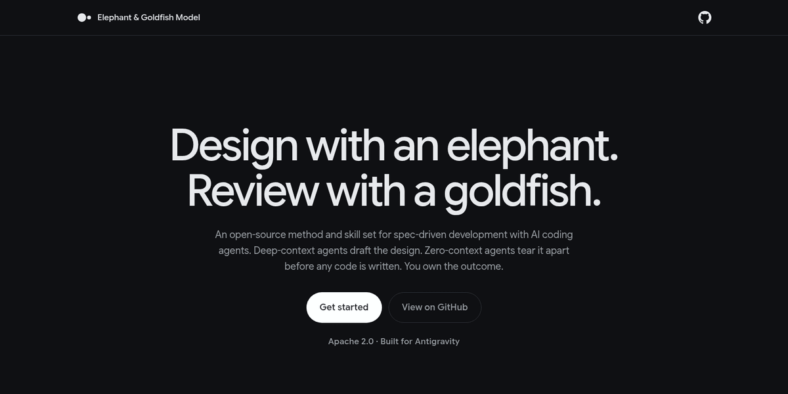
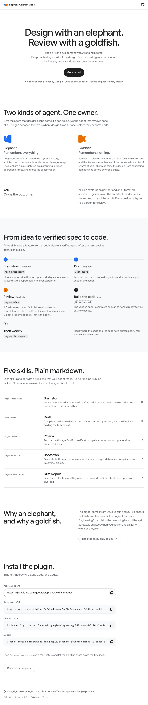
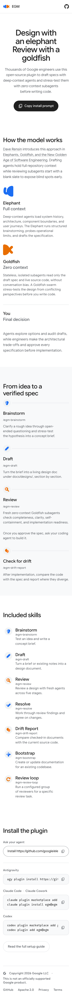

# egm.dev

GitHub Pages hosts the Elephant-Goldfish Model website at [egm.dev](https://egm.dev).

| Light | Dark |
| --- | --- |
|  |  |

<details>
<summary>Full page and mobile</summary>





</details>

## Tools and fonts

- [Astro](https://astro.build) for the static site.
- [Material Web](https://github.com/material-components/material-web) for styles.
- [Google Sans Flex](https://fonts.google.com/specimen/Google+Sans+Flex) and
  [Google Sans Code](https://fonts.google.com/specimen/Google+Sans+Code), self-hosted in
  [src/assets/fonts/](src/assets/fonts/) under the
  [SIL Open Font License](https://openfontlicense.org/).

## Rules

- Do not add analytics, cookies, or third-party scripts. Self-host fonts.
- Use only Material Web [design tokens](src/styles/tokens.css) and documented
  component properties to change the theme. Do not override component box styles.
- Match skill names and commands to the [repository README](../README.md).

## Develop

Use Node.js 22.12 or newer. Run these commands from `site/`:

```sh
npm ci
npm run dev      # http://localhost:4321
```

Before submitting changes, stop the server or use another terminal in `site/`:

```sh
npm run check
npm run build    # output: dist/
```

After visual changes, run `npm run capture`. This command requires Chrome.
If Chrome is not found, set `CHROME_PATH` to its executable path.
Edit the [social-image template](scripts/og.html) to change the social image.

## Deploy

The [Deploy site workflow](../.github/workflows/deploy-site.yml) publishes the site
when changes to `site/` reach `main`. You can also start the workflow manually.
